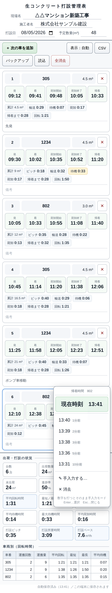
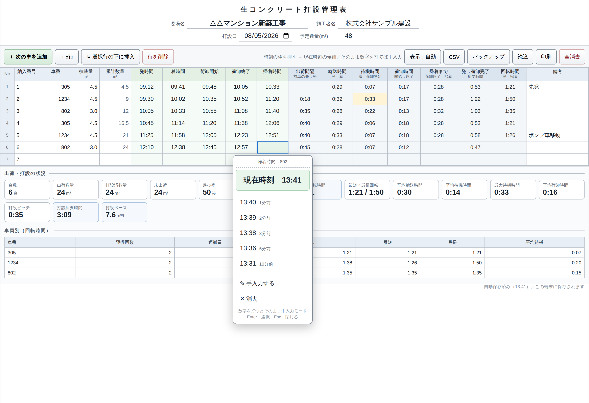

# 生コン打設管理アプリ

生コン工場のデリバリー担当者が、現場での車両の動きをその場で記録し、
**出荷ピッチ・打設にかかった時間・一車あたりの回転時間**を把握するためのウェブアプリです。

`index.html` 1ファイルだけで動作します（サーバー・インストール不要）。
スマートフォンでの記録を主に、パソコンではエクセルのような表として確認・印刷できます。

| スマホ（カード表示） | パソコン（表表示） |
| --- | --- |
|  |  |

## 使い方

`index.html` をブラウザで開くだけです。スマホではホーム画面に追加しておくとすぐ開けます。

画面幅で表示が自動的に切り替わります（ツールバーの「表示」ボタンで固定も可能）。

- **カード表示**（スマホ・タブレット）… 1台につき1枚のカード。時刻は枠を押すだけで記録
- **表表示**（パソコン）… エクセルのような表計算画面。キーボードで連続入力・印刷向き

## 記録のしかた

### 時刻は枠を押すだけ

時刻の枠を押すと、**現在時刻の候補**が出ます。

```
             発時間  車番 305
 ┌────────────────────┐
 │   現在時刻   12:41   │ ← 押すだけで記録
 ├────────────────────┤
 │ 12:40   1分前        │
 │ 12:39   2分前        │ ← 記録が少し遅れたとき
 │ 12:38   3分前        │
 │ 12:36   5分前        │
 │ 12:31  10分前        │
 ├────────────────────┤
 │ ✎ 手入力する…        │
 │ ✕ 消去               │
 └────────────────────┘
```

- **候補が出ている状態で数字を打ち始めると、「現在時刻ではない」と判断して自動的に文字入力モードに切り替わります**
  （スマホなど、キーボードが出ていないときは「✎ 手入力する…」を押してください）
- 手入力は `9` / `934` / `9:34` / `９：３４` / `9時34分` のいずれでも `09:34` に整形されます
- 解釈できない文字は赤く表示されるので、入力ミスにすぐ気付けます
- 車番・積載量・備考は、枠を押すとその場で入力できます（確定キーを押さずに次の枠を押してもかまいません）
- 車番と積載量は数字キーパッドで入力します（車番に全角や記号が混じっても、数字だけに整えます）

### 記録する項目

| 項目 | 内容 |
| --- | --- |
| 納入番号 | 車を追加すると自動で連番（変更可） |
| 車番 | 数字のみ（例：305）。数字キーパッドで入力できます |
| 積載量 | m³ |
| 累計数量 | 積載量から**自動計算**（直接入力すると、その値を基点に以降を再計算） |
| 発時間 | 工場出発 |
| 着時間 | 現場到着 |
| 荷卸開始／荷卸終了 | 現場での荷卸 |
| 帰着時間 | 工場帰着 |
| 備考 | 自由記入 |

## 自動で分かること

### 1台ごと

| 項目 | 内容 |
| --- | --- |
| 出荷間隔（ピッチ） | 前の車の発時間 → この車の発時間 |
| 輸送時間 | 発 → 着 |
| 待機時間 | 着 → 荷卸開始 |
| 荷卸時間 | 荷卸開始 → 荷卸終了 |
| 帰着まで | 荷卸終了 → 帰着 |
| 発→荷卸完了 | 発 → 荷卸終了 |
| 回転時間 | 発 → 帰着（次の出荷までの目安） |

待機時間が **30分以上は黄色**、**60分以上は赤**で強調します。
日をまたぐ時刻（23:50 → 00:15 など）も正しく計算し、12時間を超える結果は入力ミスの可能性として赤字にします。

### 全体（出荷・打設の状況）

台数／出荷数量／打設済数量／未出荷／進捗率／**平均出荷ピッチ**／**平均回転時間**／最短・最長回転／
平均輸送時間／平均待機時間／最大待機時間／平均荷卸時間／打設ピッチ（荷卸開始の間隔）／
打設所要時間（最初の荷卸開始→最後の荷卸終了）／**打設ペース（m³/h）**

### 車両別（回転時間）

車番ごとに、運搬回数・運搬量・**平均回転時間・最短・最長**・平均待機時間を集計します。
「この車は何分で回っているか」「どの車が待たされているか」がその場で分かります。

## 現場情報

画面上部に **現場名・施工者名** を中央揃えで記入できます。あわせて打設日・予定数量も記入できます
（予定数量を入れると、進捗率と未出荷量が出ます）。

## 保存・出力

- **自動保存** … 入力するたびに端末のブラウザへ保存。閉じても次に開いたとき続きから使えます
- **CSV** … エクセルでそのまま開ける形式（UTF-8 BOM付き）
- **バックアップ保存／読込** … JSONファイルで書き出し・読み戻し。端末の乗り換えや、ブラウザのデータ消去に備えて保存できます
- **印刷** … A4横で、ツールバーを除いた帳票として印刷できます（パソコンの表表示）

## パソコンでのキーボード操作（表表示）

- 矢印キー … セル移動
- `Enter` … 時刻セルは候補を表示、それ以外は入力開始（確定後は下のセルへ）
- `Tab` / `Shift+Tab` … 右／左のセルへ
- `F2`・ダブルクリック … 手入力
- `Delete` / `BackSpace` … 消去

## 補足

- データはサーバーへ送信されず、使用した端末の中だけに保存されます（端末間では共有されません）
- 自動保存はブラウザのデータ消去やプライベートモードで失われることがあります。**打設終了後は「バックアップ保存」か「CSV」で控えを残してください**
- 動作確認ブラウザ：Chrome / Edge / Safari など（最新版）
