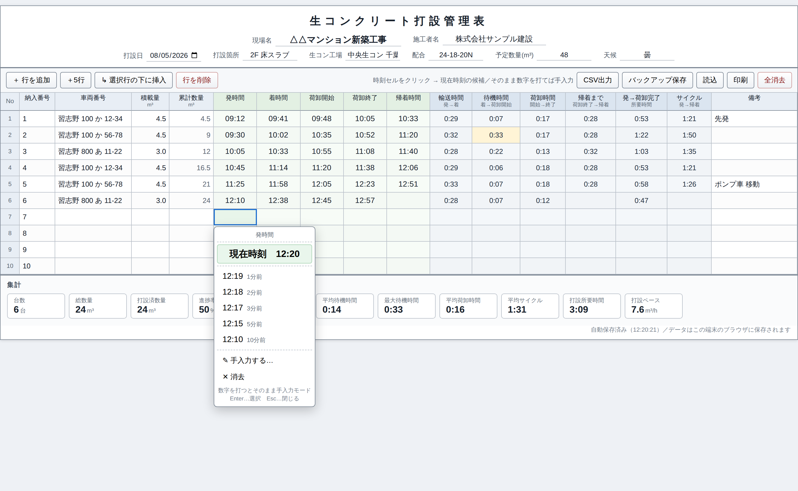

# 生コン打設管理アプリ

生コンクリート打設時の車両運行を、エクセルの表計算のような画面で記録・集計するウェブアプリです。
`index.html` 1ファイルだけで動作します（サーバー・インストール不要）。



## 使い方

`index.html` をブラウザで開くだけです。
現場のタブレット・スマートフォンでも、パソコンでも使えます。

## 主な機能

### 1. 表計算のような入力画面

| 入力する列 | 内容 |
| --- | --- |
| 納入番号 | 行追加時に自動採番（変更可） |
| 車両番号 | 例：習志野 100 か 12-34 |
| 積載量 | m³ |
| 累計数量 | 積載量から**自動計算**（直接入力すると、その値を基点に以降を再計算） |
| 発時間／着時間／荷卸開始／荷卸終了／帰着時間 | 時刻セル |
| 備考 | 自由記入 |

キーボード操作はエクセルと同じ感覚です。

- 矢印キー … セル移動
- `Enter` … 時刻セルなら時刻の候補を表示、それ以外は編集開始（確定後は下のセルへ）
- `Tab` / `Shift+Tab` … 右／左のセルへ
- `F2`・ダブルクリック … 直接手入力
- `Delete` / `BackSpace` … セルの消去

### 2. 時刻セルの入力（枠を押す → 現在時刻の候補）

時刻セルをクリックすると、**現在時刻の候補**が表示されます。

```
       発時間
 ┌───────────────────┐
 │  現在時刻   12:20  │ ← Enter でも選べます
 ├───────────────────┤
 │ 12:19   1分前      │
 │ 12:18   2分前      │
 │ 12:17   3分前      │
 │ 12:15   5分前      │
 │ 12:10  10分前      │
 ├───────────────────┤
 │ ✎ 手入力する…      │
 │ ✕ 消去             │
 └───────────────────┘
```

- その場で発生した時刻は **「現在時刻」を押すだけ**（記録が少し遅れたときのために「〇分前」も用意）
- **候補が出ている状態で数字を打ち始めると、「現在時刻ではない」と判断して自動的に文字入力モードに切り替わります**
  （タブレット等でキーボードが無い場合は「✎ 手入力する…」から）
- 手入力は `9`／`934`／`9:34`／`９：３４`／`9時34分` のいずれでも `09:34` に整形されます
- 解釈できない文字は赤字で表示されるので、入力ミスにすぐ気付けます

### 3. 時間の自動計算

入力された時刻から、各行の所要時間を自動で計算します（時:分表示）。

| 計算列 | 内容 |
| --- | --- |
| 輸送時間 | 発時間 → 着時間 |
| 待機時間 | 着時間 → 荷卸開始 |
| 荷卸時間 | 荷卸開始 → 荷卸終了 |
| 帰着まで | 荷卸終了 → 帰着時間 |
| 発→荷卸完了 | 発時間 → 荷卸終了 |
| サイクル | 発時間 → 帰着時間 |

- 待機時間が **30分以上は黄色**、**60分以上は赤色**で強調表示します
- 日をまたぐ時刻（23:50 → 00:15 など）も正しく計算します
- 12時間を超える結果は入力ミスの可能性があるため赤字にします

### 4. 集計

画面下部に、台数・総数量・打設済数量・進捗率・平均輸送時間・平均待機時間・最大待機時間・平均荷卸時間・平均サイクル・打設所要時間・打設ペース（m³/h）を自動集計します。

### 5. 現場情報

画面上部に、**現場名・施工者名**を中央揃えで記入できます。あわせて打設日・打設箇所・生コン工場・配合・予定数量・天候も記入できます（予定数量を入れると進捗率が出ます）。

### 6. 保存・出力

- **自動保存** … 入力するたびにブラウザ（localStorage）へ保存。閉じても次に開いたとき続きから使えます
- **CSV出力** … エクセルでそのまま開ける形式（UTF-8 BOM付き）
- **バックアップ保存／読込** … JSONファイルで書き出し・読み戻し。端末の乗り換えや、ブラウザのデータ消去に備えて保存できます
- **印刷** … A4横で、ツールバーを除いた帳票として印刷できます

## 補足

- データはサーバーへ送信されず、使用した端末の中だけに保存されます
- 自動保存はブラウザのデータ消去やプライベートモードで失われることがあります。**打設終了後は「バックアップ保存」または「CSV出力」で控えを残してください**
- 動作確認ブラウザ：Chrome / Edge / Safari など（最新版）
